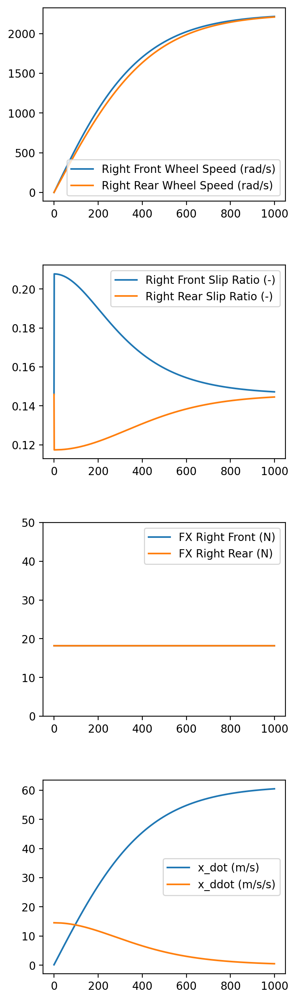

# Simulating robots with wheels

## 4 steering wheels

On GitHub I was looking for repos related to robots, and I found 4 wheel robot simulations.

### Angular velocity

First, it was [this](https://github.com/Decwest/4_wheel_steering-simulation) - in C++ and pure OpenGL. It had simple rotation equation with one rotation speed _w_ for every wheel. It was easy to compile (C++ is usually great in this regard (and if you use the right cross-platform library - **glut** in this case)), and I managed to convert this project into a 3D version in Godot.

### Torque

Then I found [Simulation for longitudinal 4 wheel drive electric vehicle](https://github.com/itrack/evlongsim) repo - seemed like exactly the right next step, because I needed more advanced simulation.

The repo was in Python and only producing a plot. Here's what author said about its functionality:

> 4 Wheel drive model of RC Car. This will be used to spec a battery and motor for FRC. 
>
> Will try to incorporate as many nonlinearities as possible with the motor, battery, and controller
>
> This script will simulate a straightline acceleration at the limits of the battery, tires, motor, and aerodynamics
>
> Drag and Lift is considered as estimations. Bluff body drag will be considered

GDScript is kinda close to Python. I put this code into Godot in Wheely.gd 

### Kalman filter

And maybe (just maybe) [this](https://github.com/GogiPuttar/Four-wheeled-robot-localization-with-Kalman-Filter) is good for theory about steering simulation and checking out how **Webots** work
